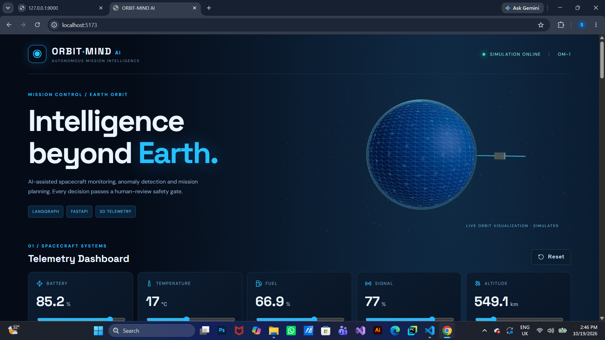
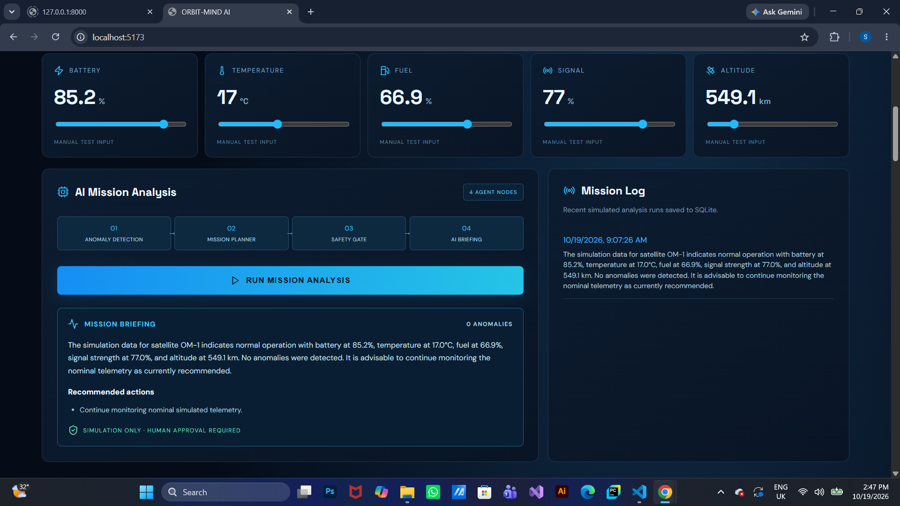
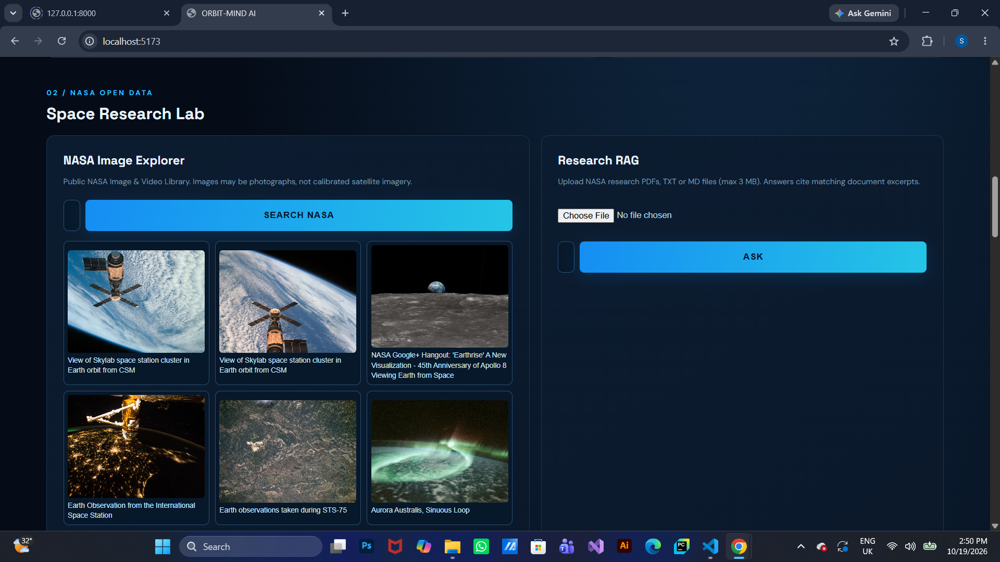
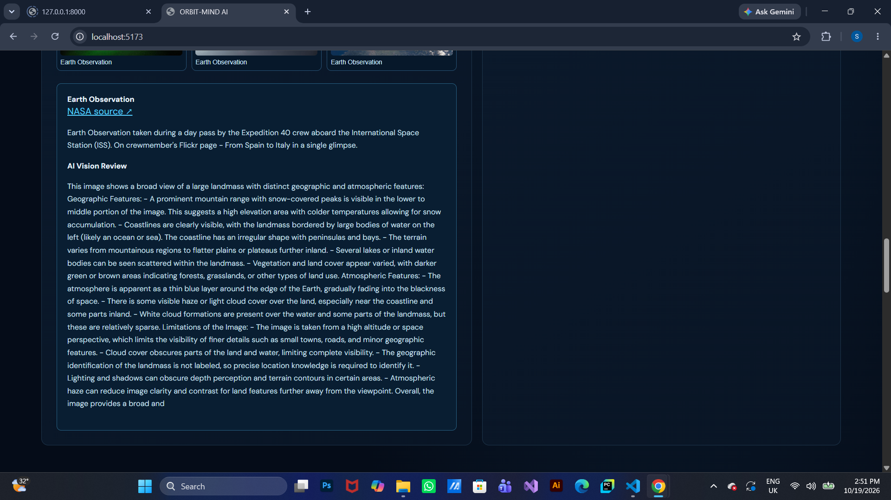
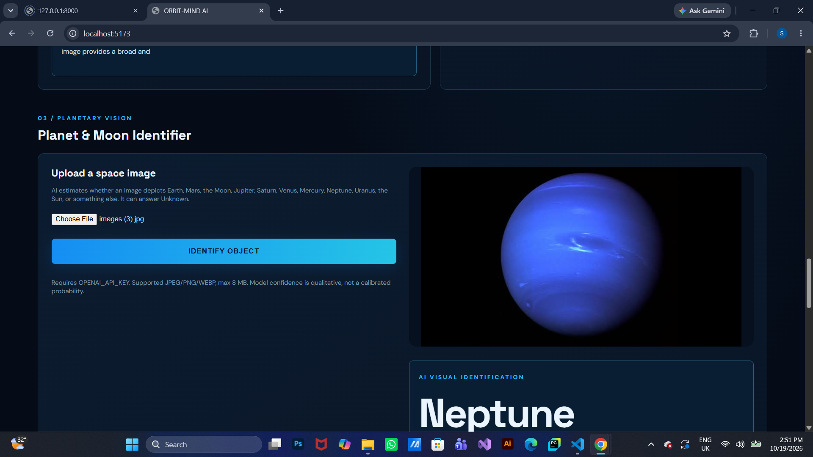
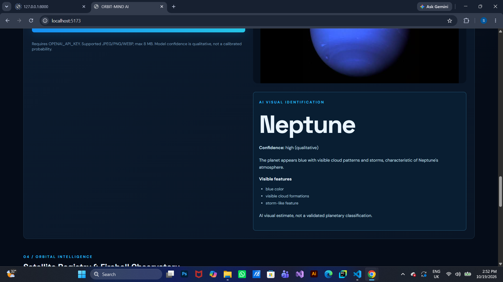
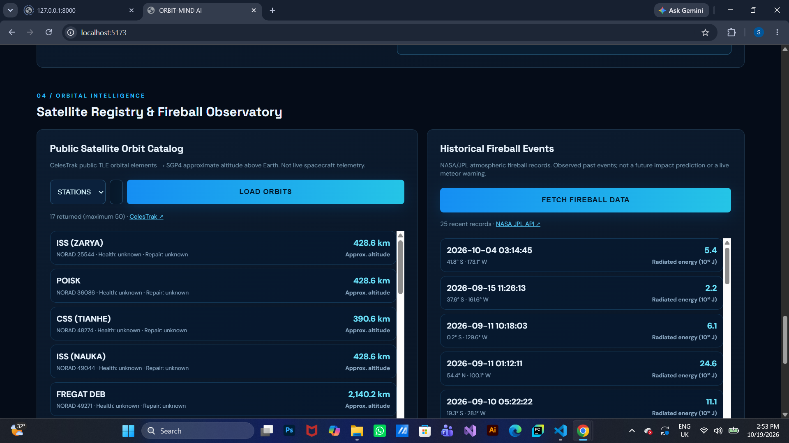
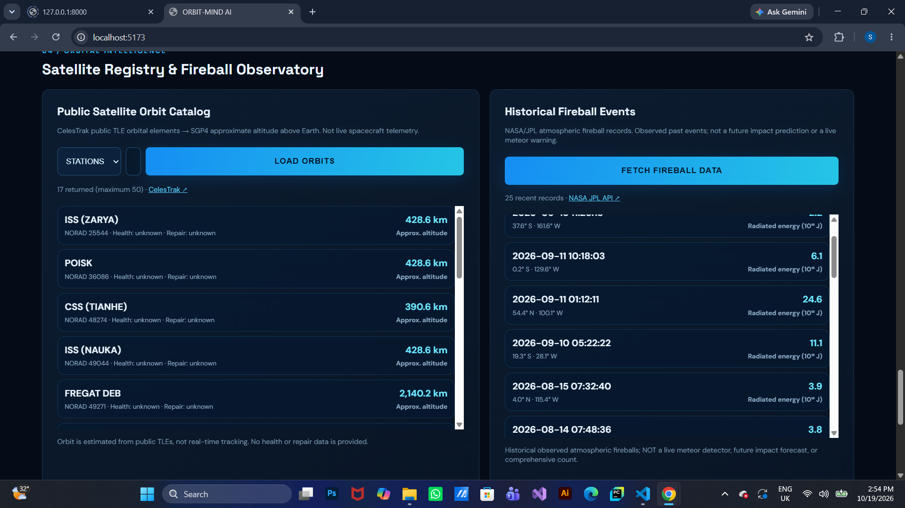
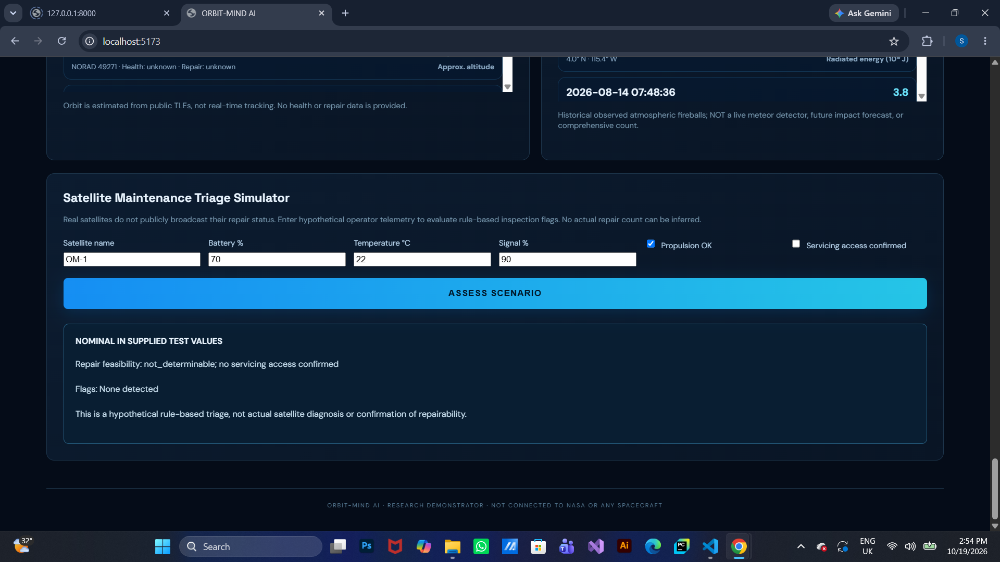
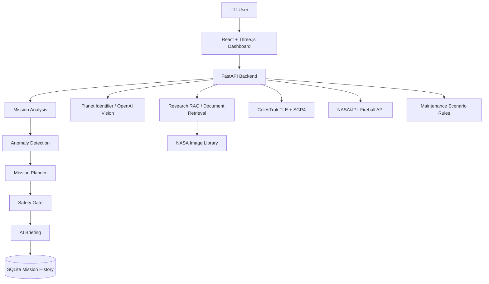

# 🛰️ ORBIT-MIND AI — Autonomous Space Mission Intelligence Platform

<p align="center">
  
  
  
  
  
  
  
  
  
  
</p>

<p align="center"><strong>Explore space data. Analyze simulated missions. Identify celestial objects. Visualize orbital intelligence.</strong></p>

<p align="center">
  <a href="#-screenshots">Screenshots</a> ·
  <a href="#-features">Features</a> ·
  <a href="#-architecture">Architecture</a> ·
  <a href="#-installation">Installation</a> ·
  <a href="#-api-reference">API</a>
</p>

---

## 📌 Overview

**ORBIT-MIND AI** is a full-stack space intelligence **research demonstrator** built with **Python, FastAPI, LangGraph, OpenAI, React, Three.js, SQLite, NASA/JPL public data, and CelesTrak orbital elements**.

It brings together four different kinds of functionality in one interactive dashboard:

1. **Simulated spacecraft operations:** manually adjustable telemetry, rule-based anomaly detection, mission planning, safety review, AI-assisted briefings, and mission history.
2. **Planetary vision:** upload an image and ask an OpenAI vision model to identify Earth, Mars, Neptune, the Moon, and other supported celestial objects.
3. **Public space-data exploration:** search NASA's image library, browse CelesTrak satellite orbital elements, and inspect NASA/JPL historical atmospheric fireball observations.
4. **Research assistance:** upload supported documents, retrieve matching excerpts, and ask questions grounded in those excerpts.

> [!IMPORTANT]
> ORBIT-MIND AI is **not affiliated with NASA**, is **not connected to any spacecraft**, and is **not a certified flight-control, satellite-maintenance, or impact-warning system**. The mission telemetry and maintenance scenarios are simulations. Public orbital data does not provide satellite health or repairability.

---

## ✨ Features

### 🚀 Mission Control & AI Workflow
- Interactive battery, temperature, fuel, signal, and altitude inputs.
- Four-stage LangGraph analysis: **Anomaly Detection → Mission Planner → Safety Gate → AI Briefing**.
- Recommended operator-review actions based on simulated telemetry.
- Optional OpenAI-assisted mission summaries.
- SQLite-backed analysis history and mission log.
- Human-approval safety messaging; no real spacecraft commands are issued.

### 🌍 3D Mission Dashboard
- Animated, stylized 3D Earth scene using React Three Fiber / Three.js.
- Orbit-inspired visualization, star field, dark-blue neon dashboard, and responsive telemetry cards.
- **Visualization is illustrative**, not a precision 3D rendering of the current position of every cataloged satellite.

### 🪐 Planet & Moon Identifier
- Image upload and preview for supported image formats.
- OpenAI vision-based object identification, including Earth, Mars, Moon, Jupiter, Saturn, Venus, Mercury, Neptune, Uranus, and Sun.
- Explanation of visible features and **qualitative** confidence description.
- `Unknown` may be returned for ambiguous or unsupported images.
- This is **not** a separately trained or benchmarked PyTorch classifier; qualitative confidence is not calibrated probability.

### 🛰️ Satellite Orbit Catalog
- Public **CelesTrak TLE/3LE** orbital elements.
- Groups including space stations, weather, science, Starlink, and active objects.
- Satellite names, NORAD catalog identifiers, and estimated orbital altitude.
- **SGP4-based position estimates** derived from orbital elements.
- Satellite health, repair requirements, and repair feasibility remain **unknown** without operator telemetry.
- Estimates are not continuous spacecraft telemetry or guaranteed real-time tracking.

### ☄️ Fireball Observatory
- Historical atmospheric fireball records from **NASA/JPL**.
- Observation timestamps, reported geographic coordinates where available, and reported energy fields.
- This is **not** a live meteor camera, meteorite detector, impact prediction engine, or exhaustive event catalog.

### 🔧 Satellite Maintenance Triage Simulator
- Enter hypothetical battery, temperature, signal, propulsion, and servicing-access values.
- Rule-based inspection flags and recommended engineering review.
- Clear separation of **user-supplied scenarios** from real spacecraft condition.
- Does not determine how many real satellites require repair or whether a specific real satellite can be serviced.

### 📚 NASA Research Lab
- Search the NASA Image and Video Library.
- Upload PDF, TXT, or Markdown research material.
- Retrieve relevant passages for source-aware question answering using local text retrieval.
- Optional AI vision analysis of selected images.
- The research retrieval layer is **not Pinecone-based** in this release.

---

<a id="-screenshots"></a>
## 📸 Project Screenshots

The following nine screenshots demonstrate the six main interface areas of ORBIT-MIND AI.

### 01 / MISSION CONTROL — Dashboard



### AI Mission Analysis



---

### 02 / NASA OPEN DATA — Space Research Lab

**NASA image exploration**



**Document research and retrieval**



---

### 03 / PLANETARY VISION — Planet & Moon Identifier

**Image upload and visual identification**



**Identification results**



---

### 04 / ORBITAL INTELLIGENCE — Satellite Registry & Fireball Observatory

**CelesTrak satellite catalog**



**NASA/JPL historical fireball observations**



### Satellite Maintenance Triage Simulator



> Screenshots are examples of local development sessions. Simulated telemetry and maintenance scenarios are not real spacecraft health data; public orbital and fireball data may change or be temporarily unavailable.

---

<a id="-architecture"></a>
## 🏗️ Architecture



### 🤖 LangGraph Mission Workflow

```text
Simulated Telemetry
       │
       ▼
01  Anomaly Detection
       │
       ▼
02  Mission Planner
       │
       ▼
03  Safety Gate
       │
       ▼
04  AI Briefing
       │
       ├──► Response to dashboard
       └──► SQLite mission history
```

| Component | Responsibility |
| --- | --- |
| React / React Three Fiber | User interface and stylized 3D scene |
| FastAPI | Typed API routes, validation, and integrations |
| LangGraph | Four-stage simulated mission-analysis workflow |
| OpenAI | Optional mission briefing and visual identification |
| SQLite | Mission analysis records |
| NASA Image Library | Public imagery discovery and metadata |
| CelesTrak + SGP4 | TLE-based satellite orbital estimates |
| NASA/JPL Fireball API | Historical atmospheric fireball observations |
| Local text retrieval | Search uploaded research documents |

---

## 🛠️ Tech Stack

| Layer | Technologies |
| --- | --- |
| Backend | Python 3.11, FastAPI, Uvicorn, Pydantic |
| AI orchestration | LangGraph |
| Vision / language AI | OpenAI API |
| Research | pypdf, scikit-learn, local text retrieval |
| Orbital calculations | sgp4 |
| HTTP integrations | httpx |
| Persistence | SQLite |
| Frontend | React 19, Vite, JavaScript, CSS |
| 3D / UI | Three.js, @react-three/fiber, @react-three/drei, Lucide icons |
| Data sources | NASA Image and Video Library, NASA/JPL Fireball API, CelesTrak |

---

## 📁 Project Structure

```text
ORBIT-MIND-AI/
├── assets/
│   └── screenshots/
│       ├── 01-dashboard.png
│       ├── 02-ai-mission-analysis.png
│       ├── 03-space-research-1.png
│       ├── 04-space-research-2.png
│       ├── 05-planet-identifier-1.png
│       ├── 06-planet-identifier-2.png
│       ├── 07-satellite-registry.png
│       ├── 08-fireball-observatory.png
│       └── 09-satellite-maintenance.png
├── backend/
│   ├── app/
│   │   ├── __init__.py
│   │   ├── main.py               # FastAPI + mission graph + SQLite
│   │   ├── classification.py     # Planet / moon identification
│   │   ├── research.py           # NASA search + document research
│   │   └── space_objects.py      # CelesTrak, fireballs, triage
│   ├── tests/
│   │   └── test_classification.py
│   ├── requirements.txt
│   ├── requirements-dev.txt
│   └── .env.example
├── frontend/
│   ├── src/
│   │   ├── main.jsx
│   │   ├── SpaceIntelligence.jsx
│   │   └── style.css
│   ├── index.html
│   ├── package.json
│   └── .env.example
├── .gitignore
└── README.md
```

---

<a id="-installation"></a>
## ⚙️ Installation

### 1. Clone the repository

```bash
git clone https://github.com/sudeeraattanayake/ORBIT-MIND-AI.git
cd ORBIT-MIND-AI
```

### 2. Start the backend (Windows PowerShell)

```powershell
cd backend
py -3.11 -m venv .venv
.\.venv\Scripts\Activate.ps1
python -m pip install --upgrade pip
python -m pip install -r requirements.txt
Copy-Item .env.example .env
```

Edit `backend/.env` and insert your own OpenAI API key.

```powershell
uvicorn app.main:app --reload --port 8000
```

API documentation: **http://127.0.0.1:8000/docs**

### 3. Start the frontend (new terminal, from repository root)

```powershell
cd frontend
npm install
Copy-Item .env.example .env
npm run dev
```

Dashboard: **http://localhost:5173**

> Requirements: Python 3.11, Node.js and npm, and an internet connection for external public data APIs and OpenAI-backed features. OpenAI API usage may incur charges.

---

## 🔐 Environment Variables

### `backend/.env`

```dotenv
OPENAI_API_KEY=your_openai_api_key_here
OPENAI_MODEL=gpt-4.1-mini
OPENAI_VISION_MODEL=gpt-4.1-mini
CORS_ORIGINS=http://localhost:5173
```

### `frontend/.env`

```dotenv
VITE_API_URL=http://localhost:8000
```

| Variable | Purpose |
| --- | --- |
| `OPENAI_API_KEY` | OpenAI authentication for vision and AI briefings |
| `OPENAI_MODEL` | Text model for AI mission summaries |
| `OPENAI_VISION_MODEL` | Vision-capable model for image identification |
| `CORS_ORIGINS` | Allowed local frontend origin |
| `VITE_API_URL` | Frontend's FastAPI base URL |

NASA Image Library, NASA/JPL fireballs, and CelesTrak public endpoints used by this version do not require an API key. **Never commit `.env` or credentials to Git.**

---

<a id="-api-reference"></a>
## 🌐 API Reference

| Method | Endpoint | Purpose |
| --- | --- | --- |
| `GET` | `/api/health` | Backend health |
| `GET` | `/api/telemetry` | Simulated telemetry |
| `POST` | `/api/analyze` | Run mission analysis |
| `GET` | `/api/history` | Recent mission analyses |
| `GET` | `/api/research/nasa-images` | Search NASA imagery |
| `POST` | `/api/research/upload` | Upload a research document |
| `POST` | `/api/research/ask` | Ask about retrieved documents |
| `POST` | `/api/research/vision` | Vision-based image review |
| `POST` | `/api/classification/upload` | Identify an uploaded space image |
| `POST` | `/api/classification/nasa` | Identify an image from NASA results |
| `GET` | `/api/classification/labels` | Supported identification labels |
| `GET` | `/api/space/satellites` | Catalog orbital estimates |
| `GET` | `/api/space/fireballs` | Historical fireball observations |
| `POST` | `/api/space/repair-assessment` | Hypothetical maintenance triage |

Explore request/response schemas in the interactive Swagger UI at `/docs`.

---

## 🔄 Example Workflows

### 🛰️ Mission Anomaly Review
1. Adjust the simulated battery or temperature values.
2. Click **Run Mission Analysis**.
3. Review the four-stage workflow and suggested actions.
4. Inspect the stored mission log.

### 🪐 Identify Neptune
1. Open **Planet & Moon Identifier**.
2. Upload a Neptune photograph.
3. Click **Identify Object**.
4. Review the predicted label, explanation, and qualitative confidence.

### 🌍 Explore Public Satellite Orbits
1. Open **Satellite Registry**.
2. Choose a supported satellite group and load orbital data.
3. Review the NORAD identifier and approximate altitude.
4. Remember that actual component health and repairability are **not available** in public TLE data.

### 📚 Ask a Research Question
1. Open **Space Research Lab**.
2. Upload a supported research document.
3. Ask a question about its contents.
4. Review the answer and supporting excerpts.

---

## 🧪 Testing

From the `backend` directory, after installing the development requirements:

```powershell
python -m pip install -r requirements-dev.txt
python -m pytest -q
```

Frontend build check:

```powershell
cd frontend
npm install
npm run build
```

The provided screenshots demonstrate selected local workflows; they are **not** a claim of production validation, full end-to-end automated test coverage, or scientific model benchmarking.

---

## ⚠️ Data Provenance & Limitations

| Data | Provenance | Important limitation |
| --- | --- | --- |
| Battery, fuel, signal, temperature | User-adjustable simulation | Not spacecraft telemetry |
| Mission briefing | Rules + optional OpenAI | Requires engineering review |
| Planet identification | OpenAI vision interpretation | May be incorrect; no calibrated accuracy score |
| NASA images | NASA public media library | Images may be photos or illustrations, not calibrated sensor data |
| Satellite positions | CelesTrak TLE + SGP4 | Estimated positions depend on orbital element age and propagation |
| Satellite health / repair | Not available in public orbit feeds | Cannot be inferred from altitude or NORAD ID |
| Meteor/fireball records | NASA/JPL historical observations | Not live warnings or future impact forecasts |
| Repair triage | User-entered hypothetical conditions | Not an engineering diagnosis |

No claims are made about controlling satellites, detecting all meteors, predicting impacts, or assessing the actual repair status of orbiting spacecraft.

---

## 🎯 Engineering Objectives

- Design a modular full-stack AI application.
- Coordinate specialized mission-analysis stages with LangGraph.
- Integrate public scientific datasets with clear provenance.
- Keep simulated operations separate from real observations.
- Present interpretable AI outputs with appropriate uncertainty.
- Demonstrate image understanding, research retrieval, orbital propagation, and interactive 3D visualization.

## 🚀 Roadmap

- [ ] Replace stylized Earth with detailed Earth textures and physically informed lighting.
- [ ] Plot estimated satellite positions and orbits directly in 3D using propagated TLE data.
- [ ] Add orbital-element age and uncertainty indicators.
- [ ] Train and evaluate a separate PyTorch planetary image classifier on licensed, labeled datasets.
- [ ] Add precision, recall, confusion matrix, and held-out test set reporting.
- [ ] Add verified near-Earth-object close-approach data with clear risk terminology.
- [ ] Introduce authenticated users, rate limits, and operational monitoring.
- [ ] Add Docker, CI/CD, and deployment documentation.
- [ ] Expand research retrieval with optional vector database support.

*Roadmap items are planned improvements, not current functionality.*

---

## 🔗 Public Data & Documentation

- [NASA Image and Video Library](https://images.nasa.gov/)
- [NASA Images API](https://images-api.nasa.gov/)
- [NASA/JPL Fireball Data API](https://ssd-api.jpl.nasa.gov/doc/fireball.html)
- [CelesTrak](https://celestrak.org/)
- [LangGraph Documentation](https://docs.langchain.com/oss/python/langgraph/overview)
- [FastAPI Documentation](https://fastapi.tiangolo.com/)

---

## 👨‍💻 Author

**Sudeera Attanayake** — AI Engineering · Agentic AI · Full-Stack AI Applications

- **GitHub:** [@sudeeraattanayake](https://github.com/sudeeraattanayake)
- **LinkedIn:** [Sudeera Attanayake](https://www.linkedin.com/in/sudeera-attanayake-9631b03b0)
- **Repository:** [ORBIT-MIND-AI](https://github.com/sudeeraattanayake/ORBIT-MIND-AI)

## 🤝 Contributing & Support

Suggestions, bug reports, and contributions are welcome through GitHub Issues and pull requests. If this project helps you explore AI-assisted space-data applications, consider starring the repository.

---

<p align="center"><strong>🛰️ ORBIT-MIND AI — Observe. Analyze. Explore.</strong></p>
<p align="center"><sub>Independent educational research demonstrator · Not an official NASA product</sub></p>
